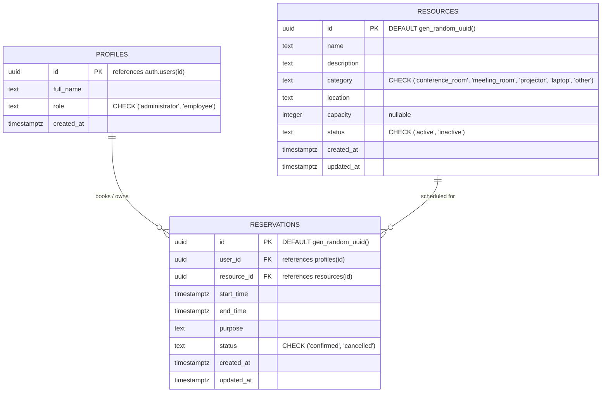

# Resource Reservation Management System (ReserveHub)

A modern, centralized web application built for organizations to manage shared resources—such as conference rooms, meeting spaces, projectors, and laptops—with zero double bookings, real-time availability checks, and role-based access control.

---

## 1. Entity-Relationship (ER) Diagram



### Database Constraints & Integrity Rules
- **No Overlapping Bookings Constraint**: PostgreSQL exclusion constraint (`EXCLUDE USING gist`) using `tstzrange(start_time, end_time)` and `resource_id` strictly for `status = 'confirmed'`.
- **Cancelled Bookings Release**: Cancelled bookings do not block time slots because the partial index excludes `status = 'cancelled'`.
- **Chronological Order Constraint**: `CHECK (end_time > start_time)` ensures proper time ranges.
- **Row-Level Security (RLS)**: Enforced on all three tables. Ordinary users cannot modify their roles or access private data outside their permissions.

---

## 2. Technology Stack

- **Framework**: Next.js 14+ (App Router)
- **Language**: TypeScript
- **Database**: Supabase PostgreSQL with `btree_gist` extension
- **Database Client**: `@supabase/supabase-js` and `@supabase/ssr` (No ORM used)
- **Authentication**: Supabase Auth (Cookie-based SSR session handling)
- **Styling**: Tailwind CSS with custom navy palette
- **Icons**: Lucide React
- **Testing**: Vitest

---

## 3. Getting Started & Installation

### Step 1: Clone and Install Dependencies
```bash
# Clone the repository
git clone <repo-url>
cd "PrimeWave Lab"

# Install project dependencies
npm install
```

### Step 2: Supabase Project Setup
1. Log in to [Supabase](https://supabase.com/) and create a new project.
2. In the project dashboard, navigate to **Project Settings** > **API**.
3. Copy the **Project URL** and the **anon / public key**.

### Step 3: Configure Environment Variables
Create a `.env.local` file in the root directory:
```bash
cp .env.example .env.local
```
Fill in your Supabase credentials:
```env
NEXT_PUBLIC_SUPABASE_URL=https://your-project-ref.supabase.co
NEXT_PUBLIC_SUPABASE_PUBLISHABLE_KEY=your-supabase-anon-key
```

### Step 4: Apply SQL Database Migrations
1. In your Supabase dashboard, open the **SQL Editor**.
2. Open the migration file located at:
   `supabase/migrations/001_initial_schema.sql`
3. Copy its entire content, paste it into the Supabase SQL Editor, and click **Run**.
4. This script will:
   - Enable the `btree_gist` extension.
   - Create `profiles`, `resources`, and `reservations` tables.
   - Set up the exclusion constraint for conflict prevention.
   - Create `create_reservation` stored procedure for atomic checks.
   - Enable and configure Row-Level Security (RLS) policies.
   - Set up the trigger to automatically populate `profiles` when users sign up.

---

## 4. Initial Administrator Account Setup

For security, users register with the default role of `employee`. Follow these steps to elevate an account to Administrator:

1. Start the application (`npm run dev`) and navigate to `http://localhost:3000/register`.
2. Register an account (e.g., `admin@organization.com`).
3. Open your Supabase dashboard > **Table Editor** > `profiles` (or open the **SQL Editor**).
4. Run the following SQL command to promote the user:
   ```sql
   UPDATE public.profiles
   SET role = 'administrator'
   WHERE id = (
     SELECT id FROM auth.users WHERE email = 'admin@organization.com'
   );
   ```
5. Log out and log back in. The user now has full administrative privileges, including resource management and admin reservation controls.

---

## 5. Running the Application

### Development Mode
```bash
npm run dev
```
Open [http://localhost:3000](http://localhost:3000) in your browser.

### Running Automated Tests
```bash
npm run test
```
Runs unit tests validating booking interval overlaps, adjacent reservation allowances, cancelled booking releases, and validation schemas.

### Production Build
```bash
npm run build
npm run start
```

---

## 6. Features & Role Matrix

| Feature | Employee | Administrator |
| :--- | :---: | :---: |
| Secure Registration & Login | ✅ | ✅ |
| Organization Dashboard & Metrics | ✅ | ✅ |
| Browse & Search Resources | ✅ | ✅ |
| Check Real-time Date/Time Availability | ✅ | ✅ |
| Book Active Resources | ✅ | ✅ |
| Personal Reservation History (Tabs & Filters) | ✅ | ✅ |
| Cancel Own Upcoming Reservations | ✅ | ✅ |
| Create, Edit, and Deactivate Resources | ❌ | ✅ |
| View Organization-Wide Reservations | ❌ | ✅ |
| Cancel Any Reservation Administratively | ❌ | ✅ |
| Resource Utilization & Booking Statistics | Summary | Full |

---

## 7. Booking Conflict Prevention & Concurrency

Double bookings are prevented using a multi-layer strategy:
1. **Frontend Validation**: Start and end times are validated; past dates are rejected; user input errors are surfaced immediately.
2. **Server-Side Verification**: Next.js Server Actions validate the inputs on the server before database operations.
3. **Database-Level Atomic Function**: The `create_reservation` PostgreSQL function verifies that the resource is active and atomic insertion is executed.
4. **PostgreSQL Exclusion Constraint**:
   ```sql
   ALTER TABLE public.reservations
     ADD CONSTRAINT no_overlapping_confirmed_reservations
     EXCLUDE USING gist (
       resource_id WITH =,
       tstzrange(start_time, end_time) WITH &&
     )
     WHERE (status = 'confirmed');
   ```
   This guarantees that even in concurrent race conditions, two conflicting reservations for the same resource can never be inserted simultaneously. Adjacent reservations (e.g., 10:00–11:00 and 11:00–12:00) are recognized as distinct non-overlapping intervals and are permitted.
