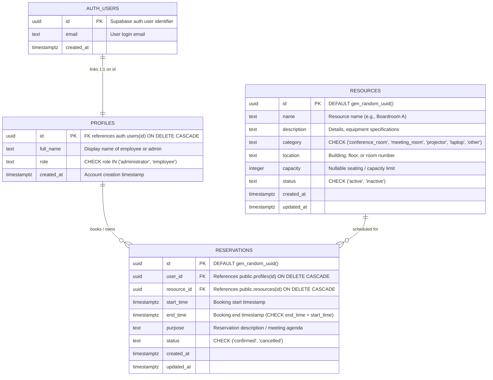

# Resource Reservation Management System (ReserveHub)

A modern, centralized web application built for organizations to manage shared resources—such as conference rooms, meeting spaces, projectors, and laptops—with guaranteed zero double bookings, real-time availability checks, and role-based access control.

---

## 1. Technologies & Frameworks

### Core Stack
- **Framework**: [Next.js 16](https://nextjs.org/) (App Router, Server Actions, Route Middleware)
- **Frontend Library**: [React 19](https://react.dev/)
- **Programming Language**: [TypeScript 5](https://www.typescriptlang.org/) (Strict Mode)
- **Styling**: [Tailwind CSS v3](https://tailwindcss.com/) with PostCSS & Autoprefixer (Custom navy design palette and responsive layout)
- **Icons**: [Lucide React](https://lucide.dev/)
- **Testing**: [Vitest](https://vitest.dev/) (Unit test suite for booking overlap algorithms & validations)

### Backend, Database & Security
- **Database**: [Supabase](https://supabase.com/) PostgreSQL with `btree_gist` extension
- **Client & Session Management**: `@supabase/supabase-js` and `@supabase/ssr` (Cookie-based SSR session management, no heavy ORM)
- **Authentication**: Supabase Auth (Email & Password, server-verified sessions via Next.js Middleware)
- **Data Protection**: PostgreSQL Row-Level Security (RLS) policies with PostgreSQL `SECURITY DEFINER` helper functions

---

## 2. Entity-Relationship (ER) Diagram



### Database Integrity & Constraints
1. **No-Overlap Exclusion Constraint (`btree_gist`)**:
   - Strictly enforces that no two `confirmed` reservations can share an intersecting time range (`tstzrange(start_time, end_time) WITH &&`) for the same resource (`resource_id WITH =`).
2. **Cancelled Bookings Release**:
   - The exclusion constraint has a partial index clause: `WHERE (status = 'confirmed')`. When a reservation is cancelled, the time slot immediately frees up without deleting historical records.
3. **Chronological Validity**:
   - `CONSTRAINT check_time_order CHECK (end_time > start_time)`.
4. **Referential Integrity**:
   - Cascading deletions on profile/resource references to prevent orphan reservations.

---

## 3. Important Technical Decisions

### 1. Database-Level Overlap Prevention (`EXCLUDE USING gist`)
- **Decision**: Avoid relying solely on application-level read-before-write checks for reservation conflicts.
- **Rationale**: Under concurrent traffic (e.g., two users booking the same conference room at the exact same millisecond), software-level `SELECT ... WHERE overlap` followed by `INSERT` suffers from race conditions. By enabling `btree_gist` and applying a PostgreSQL Exclusion Constraint on `tstzrange`, conflict rejection is guaranteed by the database engine at zero risk of double booking. Adjacent bookings (e.g., 10:00–11:00 and 11:00–12:00) remain completely valid.

### 2. Resolving RLS Infinite Recursion via `SECURITY DEFINER` Function
- **Decision**: Implemented `public.get_user_role(user_id UUID)` with `SECURITY DEFINER STABLE` to look up user roles rather than performing recursive subqueries on `profiles`.
- **Rationale**: When writing RLS policies on `public.profiles` such as:
  ```sql
  CREATE POLICY "Admins can view all profiles" ON public.profiles FOR SELECT
  USING (EXISTS (SELECT 1 FROM public.profiles WHERE id = auth.uid() AND role = 'administrator'));
  ```
  PostgreSQL evaluates RLS for the subquery referencing the same table, triggering recursive evaluation and silent query failures. The client fell back to default employee permissions. Encapsulating role retrieval in a `SECURITY DEFINER` function bypasses RLS safely and cleanly breaks recursion.

### 3. No Heavy ORM — Direct `@supabase/ssr` & Server Actions
- **Decision**: Used the official `@supabase/ssr` client package with Next.js Server Actions instead of Prisma, Drizzle, or TypeORM.
- **Rationale**:
  - Leverages native PostgreSQL features (exclusion constraints, custom trigger functions, and RLS) without ORM abstraction limitations.
  - Keeps bundle size minimal.
  - Guarantees seamless cookie synchronization between Next.js Edge Middleware and React Server Components.

### 4. Next.js App Router with Dynamic Rendering
- **Decision**: Set `export const dynamic = 'force-dynamic'` on the root application layouts and dashboard views.
- **Rationale**: Prevents stale cached authorization states or out-of-date calendar availability after a user signs in, updates profile roles, or modifies a reservation.

### 5. Webpack Fallback for Next.js 16 on Windows Environments
- **Decision**: Configured scripts (`npm run dev`, `npm run build`) to run with `--webpack`.
- **Rationale**: Turbopack in Next.js 16 requires native SWC MSVC binaries on Windows x64. When working on environments relying on WebAssembly (WASM) fallback bindings, Webpack provides 100% stability and compatibility across all platforms.

### 6. Atomic Stored Procedure (`create_reservation`)
- **Decision**: Packaged booking validation (future start dates, active resource state, end-after-start) and the insert statement inside a stored plpgsql procedure.
- **Rationale**: Single round-trip execution with structured JSON responses (`success`, `message`, `reservation_id`) surfaces clear, user-friendly error messages when constraint violations occur.

---

## 4. Features & Role Matrix

| Feature | Employee | Administrator |
| :--- | :---: | :---: |
| Secure Registration & Login | ✅ | ✅ |
| Role Display in Header (`Name (Admin)` vs Employee) | ✅ | ✅ |
| Organization Dashboard & Metrics | ✅ | ✅ |
| Browse & Search Resources (by Category, Capacity, Location) | ✅ | ✅ |
| Real-Time Date/Time Availability Checker | ✅ | ✅ |
| Book Active Resources | ✅ | ✅ |
| Personal Reservation History (Upcoming / Past / Cancelled) | ✅ | ✅ |
| Cancel Own Upcoming Reservations | ✅ | ✅ |
| Resource Management (Create, Edit, Toggle Active/Inactive) | ❌ | ✅ |
| Organization-Wide Reservation Management | ❌ | ✅ |
| Administrative Reservation Cancellation | ❌ | ✅ |
| Utilization Metrics & Analytics | Summary | Full |

---

## 5. Getting Started & Installation

### Step 1: Clone and Install Dependencies
```bash
git clone <repo-url>
cd "PrimeWave Lab"

npm install
```

### Step 2: Supabase Project Setup
1. Log in to [Supabase](https://supabase.com/) and create a project.
2. In the project dashboard, go to **Project Settings** > **API**.
3. Note your **Project URL** and the **anon / public key**.

### Step 3: Configure Environment Variables
Create `.env.local` in the project root:
```env
NEXT_PUBLIC_SUPABASE_URL=https://your-project-ref.supabase.co
NEXT_PUBLIC_SUPABASE_PUBLISHABLE_KEY=your-supabase-anon-key
```

### Step 4: Apply Database Migrations
1. Open the **SQL Editor** in your Supabase dashboard.
2. Execute `supabase/migrations/001_initial_schema.sql` (Initial tables, exclusion constraint, triggers, atomic functions).
3. Execute `supabase/migrations/002_fix_rls_recursion.sql` (Security definer role lookup and RLS recursion fixes).

---

## 6. Initial Administrator Account Setup

New accounts register with the default role `employee`. To promote an account to Administrator:

1. Register an account via `/register` (e.g., `sansika@example.com`).
2. Run the following in your Supabase **SQL Editor**:
   ```sql
   UPDATE public.profiles
   SET role = 'administrator'
   WHERE id = (
     SELECT id FROM auth.users WHERE email = 'sansika@example.com'
   );
   ```
3. Sign out and sign back in. The navigation bar will update with Administrator privileges and full management controls.

---

## 7. Running the Application

### Development Mode
```bash
npm run dev
```
Open [http://localhost:3000](http://localhost:3000) in your browser.

### Running Automated Tests
```bash
npm run test
```
Validates time overlap intervals, adjacent booking permissions, and validation schemas.

### Production Build
```bash
npm run build
npm run start
```
